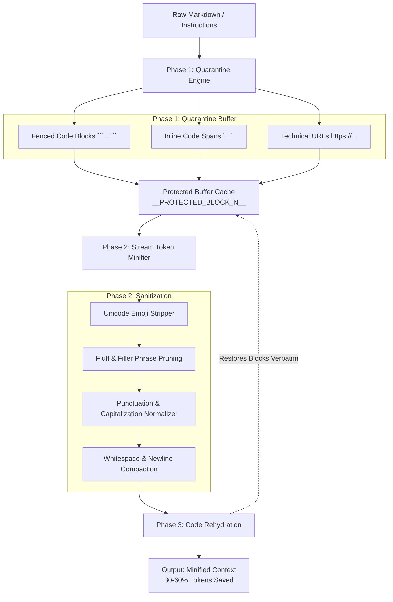

# Architecture: context-lean

`context-lean` optimizes developer prompt tokens through a three-phase isolation pipeline.

## Architectural Flow

## Guarantees

* **Zero Regressions**: Source code examples inside fenced code blocks and inline literals are never altered by even a single character.
* **URL Safety**: Query parameters and endpoint paths containing dictionary words remain completely intact.
* **Deterministic Output**: Fast synchronous execution via native Node.js string operations.
