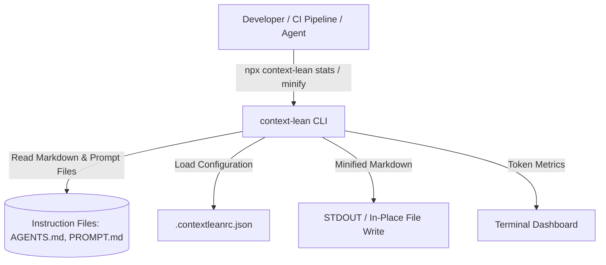
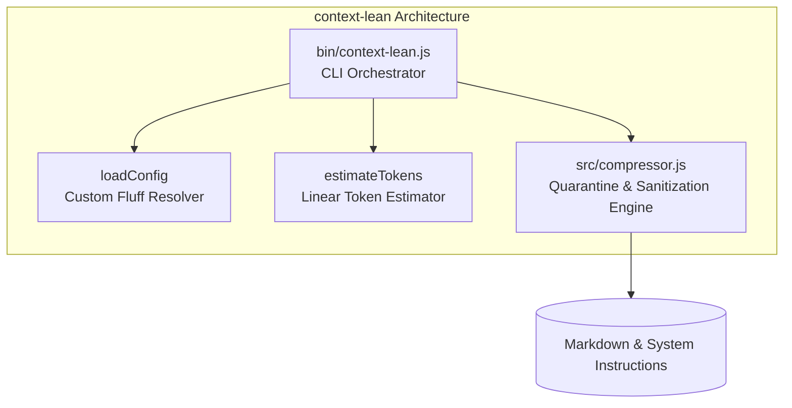
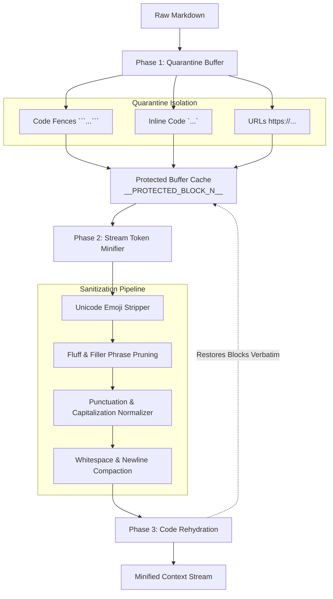
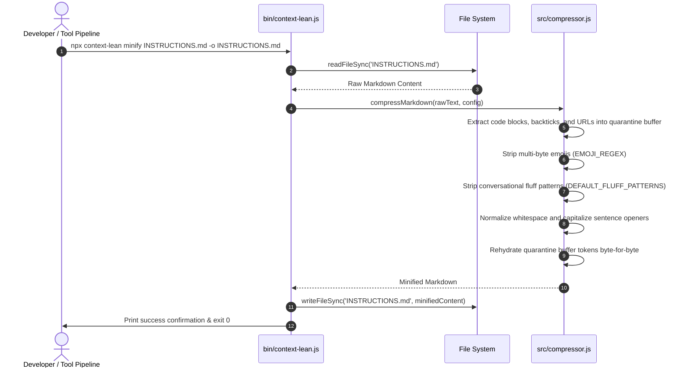

Architecture: context-lean

`context-lean` is a deterministic, zero-dependency Markdown and prompt context optimizer that reduces token overhead by 30-60% without altering executable code, file paths, or technical parameters.

1. C4 Architecture Model

Level 1: System Context Diagram

Level 2: Container Diagram

Level 3: Component Diagram

2. Sequence Diagram (Quarantine, Minify & Rehydration)

3. Mathematical Model of Prompt Token Density

Let prompt $P$ be a sequence of linguistic tokens $T = \{t_1, t_2, \dots, t_n\}$. We partition $T$ into:

$$T = T_{\text{semantic}} \cup T_{\text{code}} \cup T_{\text{fluff}} \cup T_{\text{emoji}}$$

Where:
- $T_{\text{semantic}}$: Essential instructions, schema contracts, constraints.
- $T_{\text{code}}$: Verbatim code blocks, shell commands, file paths.
- $T_{\text{fluff}}$: Conversational politeness, redundant phrases ("basically", "in order to").
- $T_{\text{emoji}}$: Multi-byte Unicode decorative symbols.

`context-lean` applies the projection operator $\Pi_{\text{clean}}$:

$$\Pi_{\text{clean}}(T) = T_{\text{semantic}} \cup T_{\text{code}}$$

Yielding token density $\rho$:

$$\rho(P') = \frac{|T_{\text{semantic}} \cup T_{\text{code}}|}{|T_{\text{original}}|}$$

Where typical real-world results yield $\rho(P') \in [0.45, 0.65]$, representing a 35% to 55% token reduction with zero loss of informational entropy.

4. Complexity & Execution Performance

- Time Complexity: $O(M)$ strictly linear time, where $M$ is the character length of the markdown document.
- Space Complexity: $O(M)$ proportional to document length to hold quarantine buffers.
- Execution Speed: Processes a 5,000-line markdown file in under 20ms on modern CPUs.
